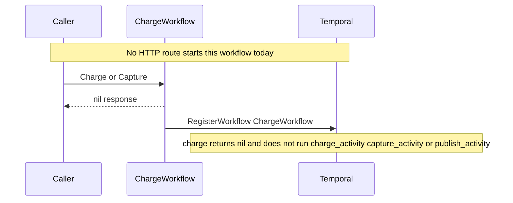

# Charge workflow

Placeholder for charging and capturing a subscription. Workflow name is `ChargeWorkflow`.

`chargeWorkflowAndActivities` registers that workflow name and does not add activities. `Charge` and `Capture` return `nil, nil`. `charge` also returns `nil, nil`. No handler or usecase calls this package.

Activity names reserved in this package, and not registered:

- `charge_activity`
- `capture_activity`
- `publish_activity`

The unused activity options in `chargeWorkflowAndActivities` match the other workflows: 25 second start-to-close timeout and 5 attempts from 1 minute up to 5 minutes.
