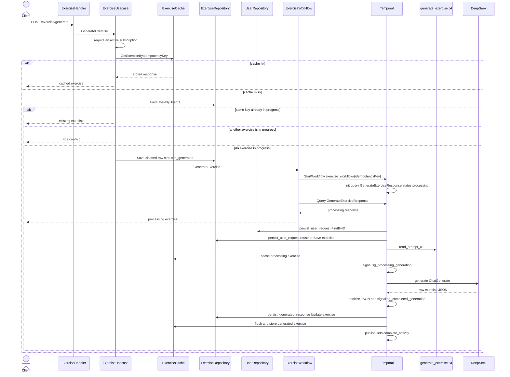

# Exercise workflow

Generates a JLPT exercise for a subscribed user. Workflow id is `exercise_workflow-{idempotencyKey}`.

The HTTP handler returns as soon as the workflow query `GenerateExerciseResponse` is readable. That query is ready while status is `processing`, so the client can receive the in-progress exercise before DeepSeek finishes. Activities keep running on Temporal after that response.

Registered order:

1. `persist_user_request_activity`
2. `read_prompt_txt_activity` signals `sg_processing_generation`
3. `generate_exercise_activity` waits for `sg_processing_generation`, then signals `sg_completed_generation`
4. `persist_generated_response_activity` waits for `sg_completed_generation`
5. `publish_activity` marks the run complete

A failed activity is named `failed_activity`. This package does not register a handler for it.

`persist_user_request` refuses a second in-progress exercise for the same user unless the idempotency key matches the row already claimed by the usecase. `read_prompt_txt` fills `files/txt/generate_exercise.txt` with the JLPT level and the question counts for that level. `generate` stores the sanitized JSON on the exercise and sets status to generated. `publish` only advances the activity name to `complete_activity`.
