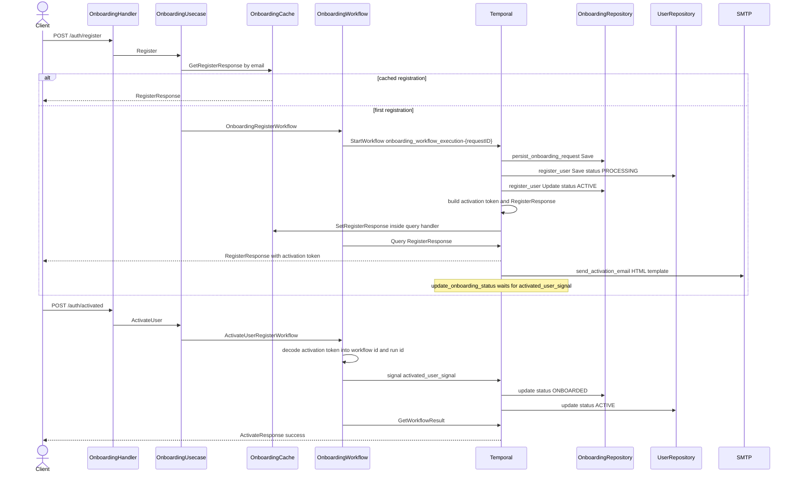

# Onboarding workflow

Registers a user and finishes activation in the same Temporal run. Workflow id is `onboarding_workflow_execution-{requestID}`.

Registered order:

1. `persist_onboarding_request_activity`
2. `register_user_activity`
3. `send_activation_email_activity`
4. `update_onboarding_status_activity` waits for signal `activated_user_signal`

`POST /auth/register` returns when query `RegisterResponse` has a response. That happens in `register_user`, before the activation email is sent and before the user opens the link. The run stays open until `POST /auth/activated` signals it.

The activation token carries the user id, onboarding id, workflow id, and run id. A failed or rejected run cancels the register wait. Input errors use the non-retryable type `OnboardingInputError`.
