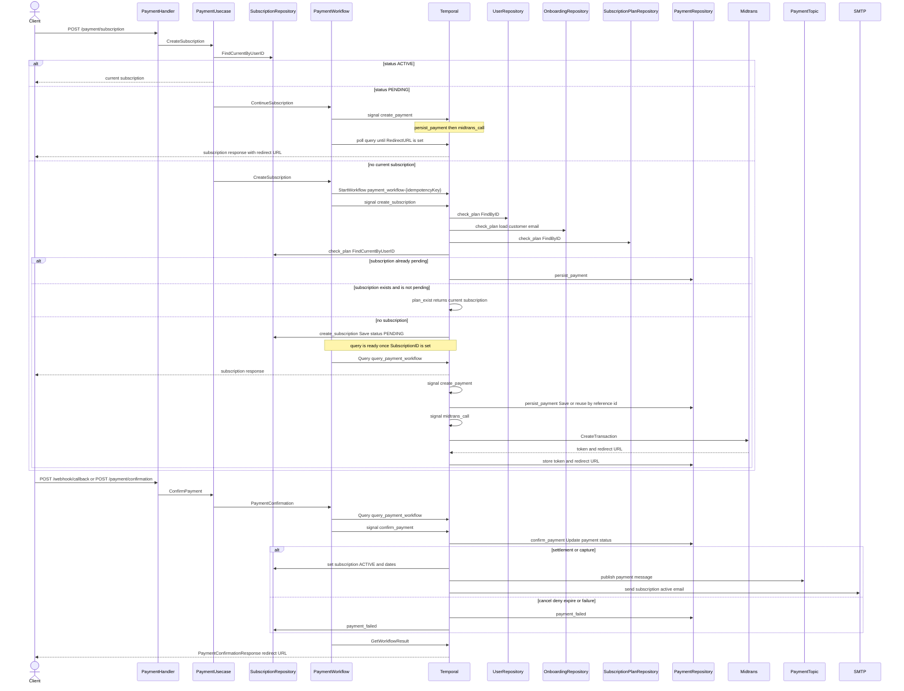

# Payment workflow

Opens a subscription payment and confirms it after Midtrans reports a result. Workflow id is `payment_workflow-{idempotencyKey}`. Query name is `query_payment_workflow`.

`POST /payment/subscription` chooses the start:

- Active subscription: the usecase returns the current row and does not start this workflow.
- Pending subscription: `ContinueSubscription` signals `create_payment` on the existing run.
- No subscription: `CreateSubscription` starts the run and signals `create_subscription`.

Registered order:

1. `check_plan_activity` waits for `create_subscription`, then picks the next activity.
2. `plan_exist_activity` when a non-pending subscription already exists.
3. `create_subscription_activity` saves a pending subscription and signals `create_payment`.
4. `persist_payment_activity` waits for `create_payment`, saves the payment, and signals `midtrans_call`.
5. `midtrans_call_activity` waits for `midtrans_call` and creates the Midtrans transaction.
6. `update_payment_status_activity` waits for `confirm_payment`.
7. `publish_payment_activity` writes the payment topic.
8. `send_subscription_email_activity` sends the active-subscription email.

`payment_failed_activity` marks the payment and subscription failed, then returns a non-retryable rejection. `cancel_payment_activity` is named on the Midtrans branch and is not registered.

`CreateSubscription` returns when the query has a subscription id, which `create_subscription` sets before Midtrans returns a redirect URL. `ContinueSubscription` keeps polling until `RedirectURL` is present. A failed or rejected run cancels that wait.

Input and rejection errors use non-retryable types and are not retried. Each activity allows 5 attempts, starting at 1 minute and backing off to 5 minutes, with a 25 second start-to-close timeout.
